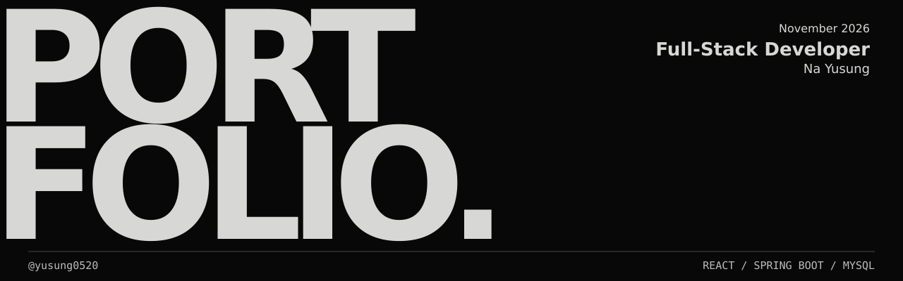

  

# 나유성 | Backend Developer

서울 정비구역의 사업 이력을 연결하고, 여러 서버를 거치는 API 요청을 추적합니다. Spring Boot와 관계형 데이터베이스를 사용해 사용자의 질문에 필요한 데이터를 제공하는 일을 합니다.

[웹 포트폴리오 소스](docs/)　/　[시연 자료 추가 방법](docs/README.md)

## Selected work

| 프로젝트 | 내가 맡은 일 | 구현 기록 |
| --- | --- | --- |
| **서울 정비구역 지도** 개인 프로젝트 | 중복된 구역명은 자동 연결을 보류하고, 매칭된 사업 이력을 14단계 지도 타임라인으로 제공합니다. | [설계와 API](https://github.com/yusung0520/real-estate-redevelopment-platform#주요-api) |
| **Sporty** 팀 프로젝트, 인프라 | 7개 서비스의 Docker 이미지를 경량화했습니다. Gateway 이미지는 150.5MiB에서 111.5MiB로 줄었고, 매치 조회 요청을 세 서비스에 걸쳐 추적했습니다. | [요청 추적 PR](https://github.com/batontouch-sporty/backend/pull/81) / [시간대 검증 PR](https://github.com/batontouch-sporty/backend/pull/89) |
| **PetCheck** 팀 프로젝트, 백엔드 | 사료 라벨의 OCR 텍스트와 반려동물별 회피 성분을 비교합니다. 클라이언트가 일치한 수와 개별 판정을 바로 읽도록 분석 응답을 구조화했습니다. | [분석 응답](projects/petcheck.md) / [RAG 저장소](https://github.com/PetCheckTeam/Petcheck-RAG) |
| **냉장고를 부탁해** 6인 팀, 팀장 및 백엔드 | 같은 이름의 식재료를 구매분별로 구분하도록 추천 요청에 식재료 ID를 담았습니다. 현재 날짜를 고정해 소비기한 당일과 만료 경계를 테스트했습니다. | [소비기한 테스트](https://github.com/amInspireCamp6th-miniProject/server/blob/develop/src/test/java/com/example/server/ingredient/domain/ExpirationPolicyTest.java) / [입력 검증](https://github.com/amInspireCamp6th-miniProject/server/blob/develop/src/test/java/com/example/server/recipe/dto/RecipeRecommendationRequestTest.java) |

## Research papers

| 논문 | 내가 맡은 일 | 연구 기록 |
| --- | --- | --- |
| **전이학습 기반 ResNet50을 활용한 피부질환 이미지 분류 및 분석 시스템 구현** 2026 한국통신학회 추계, 제1저자, 발표 예정 | 피부 이미지 3종을 분류하도록 ResNet50을 미세조정하고 웹에서 분류 결과를 확인할 수 있게 구현했습니다. 학습에 쓰지 않은 테스트 이미지 264장 중 257장을 정확히 분류했습니다(97.35%). | [학회 발표 예정 목록](https://conf.kics.or.kr/2026f/board/5463/4888#page=7) 학부논문 세션 20A-P-2 |
| **재개발·재건축 구역 정보와 중개인 연계를 결합한 부동산 플랫폼 설계 및 구현** 2026 한국통신학회 하계, 제1저자 | 원시 구역 경계를 지도용 폴리곤으로 가공하고 구역명으로 정비사업 정보와 연결했습니다. 사용자가 구역을 선택하면 진행 단계와 해당 구역 중개사의 브리핑을 함께 확인하도록 구현했습니다. | [학회 프로그램](https://conf.kics.or.kr/2026s/program) 36A-P-35 / [구현 저장소](https://github.com/yusung0520/real-estate-redevelopment-platform) |
| **사용자 물품 보호를 위한 블루투스 기반 실시간 거리 감지 및 경고 시스템** 2025 한국통신학회 추계, 제1저자 | Android 앱에서 여러 물품의 블루투스 신호 세기(RSSI)를 추적하고, 신호가 설정한 임계값 아래로 떨어지면 화면이 꺼져 있어도 진동과 푸시 알림으로 이탈을 알리도록 구현했습니다. | [학회 프로그램북](https://conf.kics.or.kr/2025f/downloadProgram?type=program) 24B-P-2 |

## About

순천향대학교 의료IT공학과 4학년, CC Lab 학부연구생입니다. 연구실에서는 표정 분석 API를 독서 화면에 연동했고, 학과 부학회장으로는 ‘마음의 소통함’을 기획해 학생회 소통부와 건의 사항을 논의했습니다.

| 교육 | 프로젝트에 연결한 경험 |
| --- | --- |
| LG CNS AM Inspire Camp | Java, Spring Boot, SQL을 활용한 기능 개발과 팀 서비스의 배포 검증 |
| NAVER Cloud Academy 소버린 AI Literacy | NCP 환경, AI API 및 RAG 연동 실습 |

## 🛠 Tech Stack

**Backend**

**Database**

**Frontend**

**Tools & AI**

RAG, CLOVA OCR, HyperCLOVA X, OpenAI API, Spring Data JPA

<strong>연구실 프로젝트</strong>

| 연구 및 프로젝트 | 담당하거나 검증한 내용 |
| --- | --- |
| 블루투스 거리 감지 및 경고 시스템 | Android와 Arduino 연동, RSSI 거리 이탈 감지와 백그라운드 알림 |
| 부동산 정보 통합 플랫폼 연구 | 공공데이터 수집, 공간 데이터 가공 및 지도 시각화 |
| 피부질환 이미지 분류 | ResNet50 전이학습, Streamlit 분석 화면. 연구용 독립 테스트 데이터셋에서 분류 정확도 97.35% |
| AI 기반 개인화 도서 추천 | 사용자 입력 화면, 추천 API 연동 및 결과 표시 |
| HopeGrip 비대면 재활 서비스 | React 기반 재활 측정 데이터 시각화와 환자 및 의료진 화면 |

