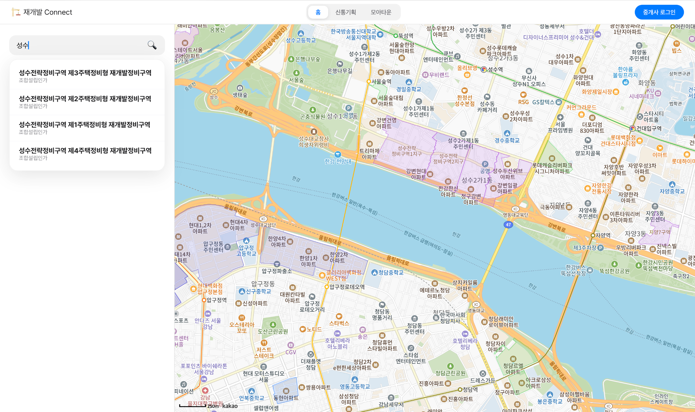
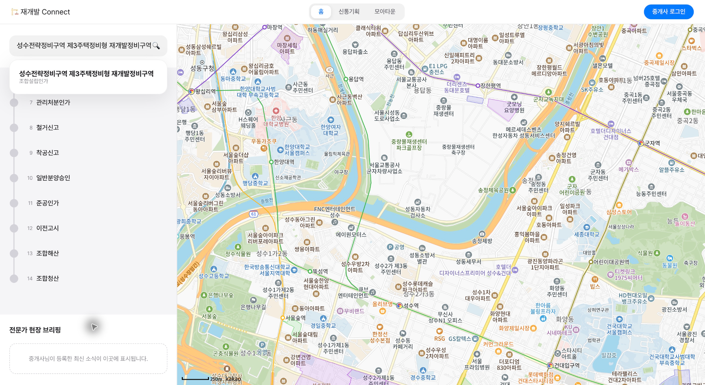
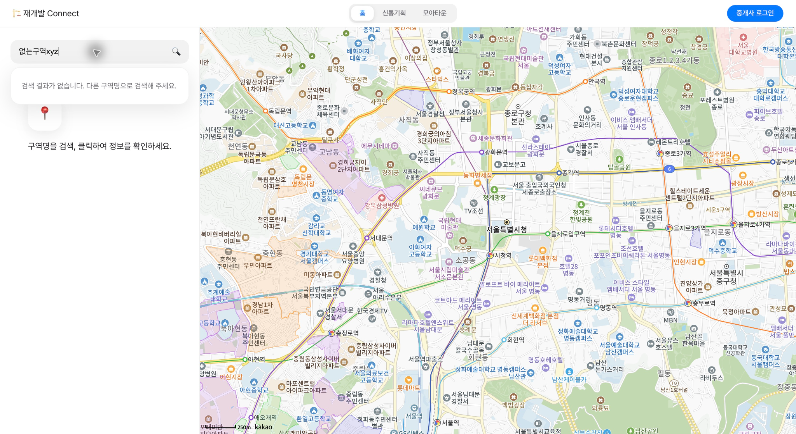

# 서울 정비구역 지도 실행 검증

2026-11-21 로컬 실행 점검, 검색 UX 보완 및 실제 시연 자료를 정리했습니다. 테스트와 브라우저 결과는 작성자의 로컬 검증 기록 기준이며, GitHub 소스에서 해당 설정과 변경 내용을 확인할 수 있습니다.

- **검증 소스:** [b01e631 · 실행 환경 및 검색 UX 정리](https://github.com/yusung0520/real-estate-redevelopment-platform/commit/b01e63166c0765241387d137081cfef448154c72)
- **데이터 기준:** 2026-03-19 SQL 백업. 현재 정비사업 현황을 나타내지 않습니다.
- **실행 환경:** JDK 17, Gradle Wrapper 8.12.1, Spring Boot 3.4.1, React/Vite, 별도 포트 3307의 MySQL 8.0.44
- **실제 자료:** [약 27초 시연 영상](https://raw.githubusercontent.com/yusung0520/yusung0520/main/docs/media/redevelopment-demo.mp4), 아래 캡처 4장

## 복원 후 확인한 데이터

| 항목 | 건수 | 의미 |
| --- | ---: | --- |
| `areas_v3` | 2,302 | 저장된 전체 구역 |
| `cleanup_cafes` | 1,085 | 수집된 사업장 |
| `cleanup_progresses` | 1,869 | 저장된 단계 이력 |
| `source_documents` | 249 | 저장된 문서 |
| 목록 API 전체 조회 대상 | 440 | 사업장과 연결되고 구역 테이블에도 존재하는 구역 |

목록의 440건과 전체 구역 2,302건은 서로 다른 범위입니다. 사업장에 기록된 고유 구역 ID 중 구역 테이블에 대응 행이 없는 6개는 목록에서 제외됩니다. 검증 과정에서 자동 수집과 DB 초기화를 실행하지 않았습니다.

## API 및 브라우저 검증

| 요청 | 결과 | 확인한 응답 |
| --- | --- | --- |
| `GET /api/areas?page=0&size=20` | HTTP 200 | 전체 440건, 22페이지, 첫 페이지 20건 |
| `GET /api/areas/search?q=성수` | HTTP 200 | 5건 반환: 678~681 및 750 |
| `GET /api/areas/678/detail` | HTTP 200 | 폴리곤, 현재 단계, 날짜가 있는 이력 2건 |

검색 API는 5건을 반환합니다. 화면은 단계 정보가 없는 ID 750을 제외하므로 성수전략정비구역 1~4구역의 4개 결과가 보입니다.

브라우저에서는 배경 지도와 폴리곤 표시, 성수 검색, 제3구역 선택, 경계 강조, 현재 단계와 날짜, 14단계 하단까지 확인했습니다. 제2구역으로 바꾸면 날짜가 `2020.3.6`으로 바뀌며 이전 상세가 남지 않았습니다. 패널을 닫은 후 재검색과 재선택도 확인했습니다.

| 제3구역 이력 | API 날짜 | 화면 표시 |
| --- | --- | --- |
| 조합설립추진위원회승인 | 2009-10-27 | 2009.10.27 |
| 조합설립인가 | 2019-02-27 | 2019.2.27 |

**14개는 UI의 기준 단계 수입니다.** 구역 678의 실제 이력은 2건이며, 기록이 없는 단계에는 날짜를 표시하지 않습니다.

핵심 시연 점검에서는 지도 타일 요청 HTTP 200, 브라우저 콘솔 오류 0건, 관측한 네트워크 요청 85건 중 HTTP 4xx/5xx 0건을 확인했습니다. 의도적으로 요청 실패를 발생시킨 검색 오류 테스트는 이 수치와 별도입니다. 이전 지도 타일 미표시 현상의 정확한 원인은 확정하지 않았습니다.

## 검색 UX 보완

| 상황 | 처리와 확인 결과 |
| --- | --- |
| 검색어 입력 중 | 기존 상세 유지 |
| 빈 결과 확정 | 결과 없음 안내, 이전 상세와 지도 선택 강조 해제 |
| 정상 재검색 | 결과 표시 및 구역 재선택 가능 |
| 요청 실패 | 빈 결과와 구분된 오류 안내 |
| 오프라인 해제 | 정상 검색 복구 |
| 검색창 접근성 | `id`, `name`, `aria-label` 추가 |

빈 결과와 요청 실패 처리는 `App.jsx`에서 구분합니다. 지도 선택 해제 시 강조 폴리곤은 `KakaoMap.jsx`에서 원래 스타일로 되돌립니다. `AreaListPage.jsx`는 현재 앱에서 라우팅되지 않아 실제 화면 검증 대상에 포함하지 않았습니다.

## 실행 환경과 자동화 검사

| 검사 | 결과 | 검증 범위 |
| --- | --- | --- |
| 프런트 `npm run lint` | 통과 | ESLint |
| 프런트 `npm run build` | 통과 | 프로덕션 빌드 |
| 백엔드 JUnit 테스트 | 2개 통과 | 컨텍스트 로드와 H2 격리 설정 |
| 백엔드 Gradle build | 통과 | 빌드 및 실행 JAR 생성 |
| `git diff --check` | 통과 | 변경 내용 공백 검사 |

Gradle Wrapper JAR, 실행 권한, JUnit Platform launcher 의존성 및 기존 lint 오류를 정리했습니다. 테스트는 `test` 프로필의 인메모리 `jdbc:h2:mem:portfolio-test`를 사용하며 3306·3307 DB에 연결하지 않습니다. 기본 설정은 DDL 변경, SQL 초기화, 자동 수집을 비활성화합니다.

**자동화 테스트 2개가 서비스 전체 기능을 보장하지는 않습니다.** 실제 지도·검색·상세 흐름은 복구 DB에 연결한 브라우저에서 별도로 확인했습니다. 실행 명령은 [프로젝트 README](https://github.com/yusung0520/real-estate-redevelopment-platform#로컬-실행-및-검증)에 있습니다.

## 실제 화면

### 성수 검색 결과

단계 정보가 있는 4개 구역을 보여줍니다.

### 제3구역 상세 및 날짜

2009.10.27과 2019.2.27이 표시됩니다. 캡처에는 1~9단계가 보이며, 현재 단계 표시는 백업 시점 기준입니다.

### 14단계 하단

마지막 14단계까지 UI가 이어지며, 이력이 없는 단계에는 날짜가 없습니다.

### 검색 결과 없음

안내 문구가 표시되고 이전 상세 패널이 해제됩니다.

### 실제 시연 영상

[시연 영상 열기 · 약 27초](https://raw.githubusercontent.com/yusung0520/yusung0520/main/docs/media/redevelopment-demo.mp4)

원본 45초 녹화에서 시작 대기 18초를 줄인 웹 재생본입니다. 검색, 제3구역 선택, 날짜 확인, 타임라인 스크롤의 실제 UI와 순서는 유지했습니다. 빈 검색 결과 캡처는 후속 UX 보완 후 촬영했습니다.

## 남은 범위

- 프런트 번들 약 767KB에 대한 크기 경고가 있습니다. 빌드 실패는 아닙니다.
- 백엔드의 deprecated API 및 unchecked 연산 경고가 남아 있습니다.
- 구역 678의 `history`와 `agents`는 빈 배열이며 현장 브리핑은 빈 상태입니다.
- 백업 이후의 사업 현황, 공개 서비스 운영, 모든 구역의 정합성은 이번 검증 범위에 포함되지 않습니다.

## 구현 근거

- [검색 상태와 예외 처리](https://github.com/yusung0520/real-estate-redevelopment-platform/blob/main/frontend/src/App.jsx)
- [지도와 구역 선택](https://github.com/yusung0520/real-estate-redevelopment-platform/blob/main/frontend/src/components/KakaoMap.jsx)
- [상세 및 타임라인 화면](https://github.com/yusung0520/real-estate-redevelopment-platform/blob/main/frontend/src/pages/AreaDetailPage.jsx)
- [목록 조회 조건](https://github.com/yusung0520/real-estate-redevelopment-platform/blob/main/backend/Real_estate_backend/src/main/java/com/yusung/realestateapi/backend/area/infra/AreaV3Repository.java)
- [상세 응답 구성](https://github.com/yusung0520/real-estate-redevelopment-platform/blob/main/backend/Real_estate_backend/src/main/java/com/yusung/realestateapi/backend/area/application/AreaQueryService.java)
