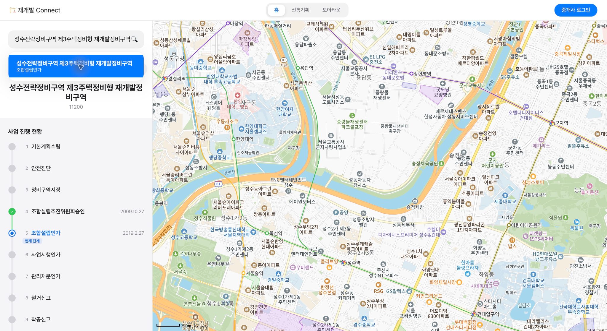

# 서울 정비구역 지도 실행 검증

이 문서는 작성자가 제공한 2026년 11월 로컬 복구 및 실행 점검 결과를 정리한 기록입니다. 원격 운영 서비스의 상태나 현재 정비사업 현황을 나타내지 않습니다.

- **데이터 기준:** 2026-03-19 SQL 백업
- **검증 환경:** MySQL 8.0.44 Docker 컨테이너, JDK 17, Spring Boot 3.4.1, React/Vite
- **검증 방법:** 원본 덤프 해시 대조, 복원 후 SQL 건수 조회, HTTP API 요청, 브라우저에서 핵심 흐름 확인
- **소스 상태:** 복구 과정에서 애플리케이션 소스 수정 없음

## 복원 후 확인한 데이터

| 항목 | 건수 | 의미 |
| --- | ---: | --- |
| `areas_v3` | 2,302 | 저장된 전체 구역 |
| `cleanup_cafes` | 1,085 | 수집된 사업장 |
| `cleanup_progresses` | 1,869 | 저장된 단계 이력 |
| `source_documents` | 249 | 저장된 문서 |
| 목록 API의 전체 조회 대상 | 440 | 사업장 정보와 연결되고 구역 테이블에도 존재하는 구역 |

목록의 440건과 전체 구역 2,302건은 서로 다른 범위입니다. 목록 API는 `cleanup_cafes`와 연결된 구역만 조회합니다. 사업장에 기록된 고유 구역 ID 중 구역 테이블에 대응 행이 없는 6개는 목록에 포함되지 않습니다.

## API 검증

| 요청 | 결과 | 확인한 응답 |
| --- | --- | --- |
| `GET /api/areas?page=0&size=20` | HTTP 200 | 전체 440건, 22페이지, 현재 페이지 20건 |
| `GET /api/areas/search?q=성수` | HTTP 200 | 5건 반환, 구역 ID 678~681 포함 |
| `GET /api/areas/678/detail` | HTTP 200 | 폴리곤, 현재 단계, 날짜가 있는 타임라인 이력 2건 |

## 브라우저에서 확인한 흐름

1. 배경 지도에서 도로, 역, 지명과 구역 경계 폴리곤 표시
2. ‘성수’ 검색
3. 성수전략정비구역 제3구역(`areaId=678`) 선택
4. 상세 패널과 백업 데이터의 현재 단계 표시
5. API 날짜와 화면의 날짜 대조
6. 14개 기준 단계 전체 표시 및 이력이 없는 단계의 빈 날짜 확인

| 이력 | API 날짜 | 화면 표시 |
| --- | --- | --- |
| 조합설립추진위원회승인 | 2009-10-27 | 2009.10.27 |
| 조합설립인가 | 2019-02-27 | 2019.2.27 |

**14개 기준 단계는 UI 구조입니다.** 구역 678의 실제 이력은 2건이며, 나머지 단계는 날짜 없이 비활성 상태로 표시됩니다. 14개 단계 모두의 인가 기록이 확보됐다는 의미가 아닙니다.

## 확인 범위와 남은 작업

- 구역 678의 `history`와 `agents`는 빈 배열입니다. 해당 구역의 ‘전문가 현장 브리핑’은 빈 상태로 확인했습니다.
- 지도 타일은 실제 화면에 표시됐지만 개별 타일 요청의 HTTP 상태와 브라우저 콘솔은 직접 검사하지 못했습니다. 이전 타일 미표시 현상의 원인은 확정하지 않았습니다.
- 백업 이후 사업 현황은 이번 검증 범위에 포함되지 않습니다.
- 프런트 프로덕션 빌드와 백엔드 JAR 패키징은 선행 점검에서 성공했습니다. 백엔드 JAR 패키징은 테스트를 제외한 결과입니다.
- Gradle wrapper JAR와 실행 권한 문제, 테스트 런타임 의존성 문제, 기존 ESLint 오류 4건은 별도 정리가 필요합니다. DB 복원 성공을 전체 테스트 통과로 해석하지 않습니다.
- 현재 로컬 실행은 설치된 Gradle 9.7.1을 사용했습니다. 저장소 wrapper 설정의 9.2.1과 차이가 있어 실행 환경을 정리해야 합니다.
- 실제 검색 결과와 상세 화면 캡처 2장을 아래에 첨부했습니다. 상세 캡처에는 14개 기준 단계 중 1~10단계가 보입니다. 전체 14단계 확인은 앞서 제공된 로컬 실행 점검 기록을 근거로 합니다.

## 실제 화면

### 성수 검색 결과

캡처에는 성수전략정비구역 1~4구역이 보입니다. 검색 API의 전체 반환 건수와 화면에 보이는 목록의 범위를 구분합니다.

### 제3구역 상세 및 타임라인 상단

추진위원회 승인 2009.10.27과 조합설립인가 2019.2.27이 표시됩니다. 화면의 현재 단계는 백업 시점 기준이며, 현재 정비사업 현황을 뜻하지 않습니다.

## 구현 근거

- [지도와 구역 선택](https://github.com/yusung0520/real-estate-redevelopment-platform/blob/main/frontend/src/components/KakaoMap.jsx)
- [상세 및 타임라인 화면](https://github.com/yusung0520/real-estate-redevelopment-platform/blob/main/frontend/src/pages/AreaDetailPage.jsx)
- [목록 조회 조건](https://github.com/yusung0520/real-estate-redevelopment-platform/blob/main/backend/Real_estate_backend/src/main/java/com/yusung/realestateapi/backend/area/infra/AreaV3Repository.java)
- [상세 응답 구성](https://github.com/yusung0520/real-estate-redevelopment-platform/blob/main/backend/Real_estate_backend/src/main/java/com/yusung/realestateapi/backend/area/application/AreaQueryService.java)
