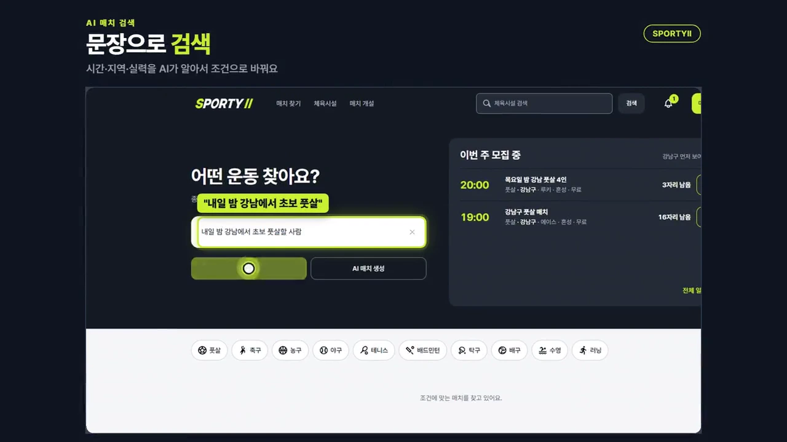
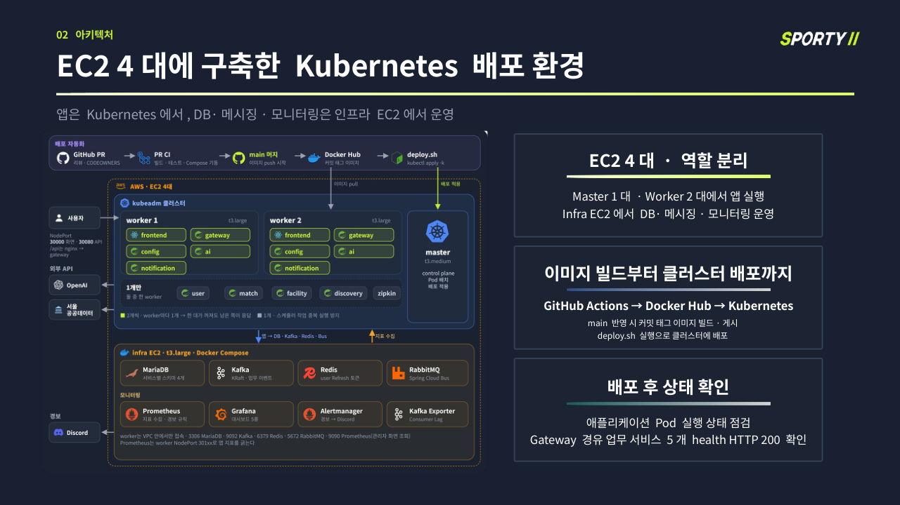
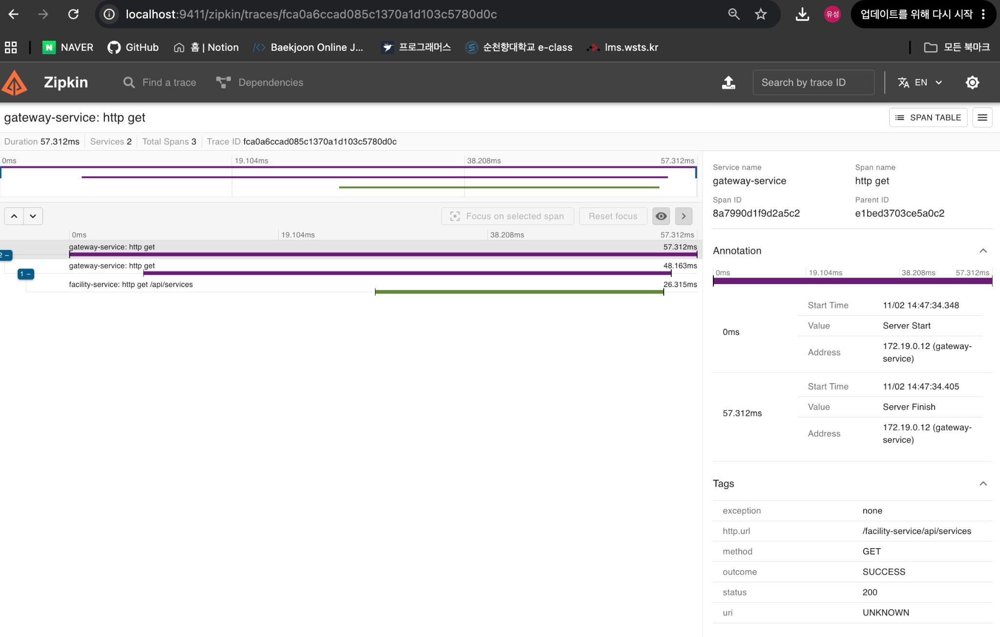

# Sporty — 생활체육 매칭 서비스

함께 운동할 사람과 장소를 찾고, 매치를 직접 개설하거나 참가하는 8인 팀 프로젝트입니다. 자연어 기반 AI 검색, 시설 조회, 참가와 보증금 처리, 대기자 자동 승급과 알림을 하나의 흐름으로 연결했습니다.

## 서비스가 제공하는 기능

| 흐름 | 사용자에게 제공하는 기능 |
| --- | --- |
| 찾기 | 운동·시간·지역·실력 조건을 자연어로 검색하고 시설 정보를 확인 |
| 만들고 참가하기 | AI로 매치 생성 항목을 채우고 참가 신청 및 보증금 내역 확인 |
| 기다리기 | 정원이 찬 매치에 대기 등록, 취소 발생 시 자동 승급 및 알림 |

[팀 서비스 시연 · 1분 33초](https://raw.githubusercontent.com/yusung0520/yusung0520/main/docs/media/sporty-service-demo.mp4)

영상은 팀이 함께 구현한 서비스 결과입니다. AI·매칭·회원·알림 등 업무 기능은 각 담당자가 구현했으며, 아래는 제가 맡은 작업입니다.

## 내 역할 — 인프라와 배포

팀 발표자료 6쪽의 역할 분담: **나유성 / Compose·Kafka 환경, Kubernetes·AWS 배포**.

- **환경 구성과 배포:** Compose 환경 구성, AWS·Kubernetes 배포 및 실행 상태 점검.
- **컨테이너 경량화:** 7개 서비스 이미지 경량화. Gateway 이미지 150.5MiB → 111.5MiB, 약 25.9% 감소. 변경 이미지 기동 후 HTTP 200 확인.
- **분산 요청 추적:** Gateway·User·Match·Facility·AI·Notification에 추적 설정 적용. 매치 조회의 Gateway → Match → User 호출이 같은 Trace ID로 연결되는지 확인.
- **시간대 수정:** 알림의 9시간 차이를 해결하기 위해 서비스·DB 시간대 통일. 생성·읽음 요청 시각과 DB 저장값을 대조.

## 배포 구성

Master 1대와 Worker 2대의 Kubernetes 클러스터에서 애플리케이션을 실행하고, 별도 인프라 EC2 1대에서 DB·Kafka·Redis·RabbitMQ와 모니터링을 운영했습니다. 전체 EC2는 **4대**, Kubernetes 노드는 **3대**입니다.

배포 후 Pod 상태와 Gateway를 경유한 업무 서비스 5개의 health HTTP 200 응답을 확인했습니다. 팀 발표자료 15쪽에 배포 구성이, 38쪽에 Kubernetes와 Compose를 함께 사용한 이유가 기록돼 있습니다. 배포 CI와 모니터링 구현 등은 팀의 역할 분담에 따라 진행했습니다.

## 요청 추적 근거

이 캡처는 **Gateway → Facility**의 `GET /api/services` 요청입니다. 서비스 2개, span 3개가 표시되며 선택한 Gateway span은 HTTP 200입니다. 57.312ms는 단일 trace의 측정값이며 평균 성능이나 개선율이 아닙니다.

Gateway → Match → User 요청 확인 기록은 [PR #81](https://github.com/batontouch-sporty/backend/pull/81)에 있습니다. 이 시설 조회 캡처와는 다른 요청입니다.

## 팀 장애·복구 시연

[장애·복구 시연 · 2분 20초](https://raw.githubusercontent.com/yusung0520/yusung0520/main/docs/media/sporty-recovery-demo.mp4)

시설 서비스 중단 시 조회·생성의 동작 차이, 알림 서비스 재시작 후 메시지 처리, 탈퇴 거절과 보상 처리, 권한·상태 검증을 보여줍니다. 영상 속 모니터링·Saga·업무 로직은 각 담당자의 구현이며, 제 기여는 인프라 환경과 배포, 요청 추적 및 설정 검증입니다.

## 구현 기록

- [서비스 간 요청 추적 PR #81](https://github.com/batontouch-sporty/backend/pull/81)
- [시간대 설정 및 검증 PR #89](https://github.com/batontouch-sporty/backend/pull/89)

이 문서는 개인 포트폴리오 저장소의 구현 기록입니다. 원본 팀 저장소는 변경하지 않았습니다.
